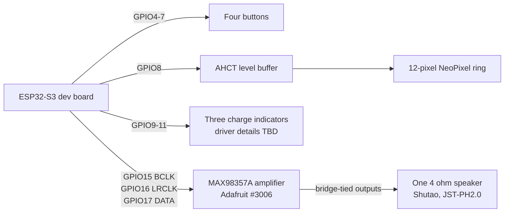
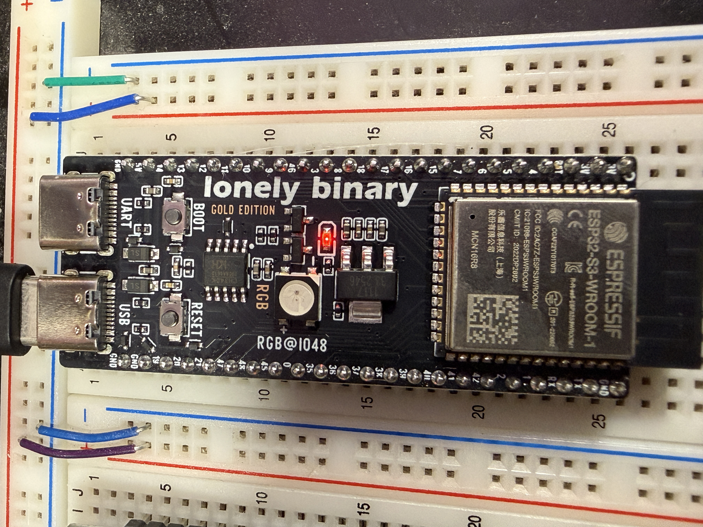
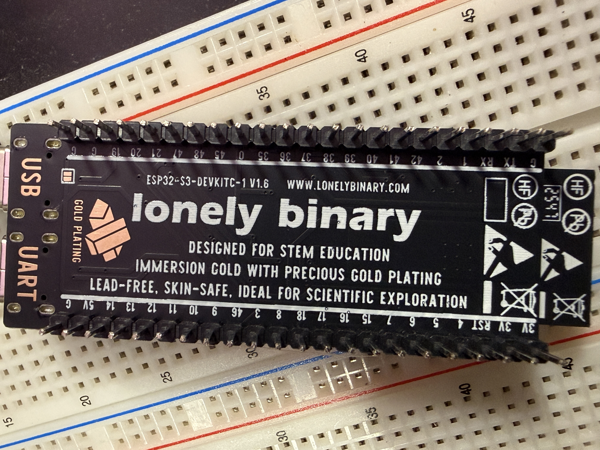

# Hardware connections

This page documents the intended hardware wiring for the Lonely Binary
ESP32-S3-DEVKITC-1 V1.6 board with ESP32-S3-WROOM-1 N16R8. The GPIO numbers
below are the `IOxx` labels printed beside the board headers, not physical
header positions. See the [board photos](#board-reference) and
[ADR-0008](../adr/0008-gpio-allocation.md).

## Signal overview

The overview shows signal paths only. Power, ground, protection, current
limiting, and connector details are not implied by the arrows. For the exact
electrical connections, use the tables below and the referenced ADRs.

## GPIO assignments

| Board header label | GPIO | Connects to | Electrical connection / design note |
| --- | ---: | --- | --- | --- |
| IO4 | 4 | Trigger switch | Switch between GPIO and common GND; active low with internal pull-up |
| IO5 | 5 | Portal color button | Switch between GPIO and common GND; active low with internal pull-up |
| IO6 | 6 | Acceleration curve button | Switch between GPIO and common GND; active low with internal pull-up |
| IO7 | 7 | Discharge direction button | Switch between GPIO and common GND; active low with internal pull-up |
| IO8 | 8 | NeoPixel data path | GPIO data to AHCT buffer, then buffer output to ring data input |
| IO9 | 9 | Charge indicator 1 | Control output; LED driver/current-limit circuit remains to be designed |
| IO10 | 10 | Charge indicator 2 | Control output; LED driver/current-limit circuit remains to be designed |
| IO11 | 11 | Charge indicator 3 | Control output; LED driver/current-limit circuit remains to be designed |
| IO12 | 12 | Muzzle emitter enable | Reserved for the deferred muzzle emitter; unused in this build |
| IO15 | 15 | MAX98357A BCLK | I2S bit clock |
| IO16 | 16 | MAX98357A LRC/LRCLK | I2S word select |
| IO17 | 17 | MAX98357A DIN | I2S data out from ESP32 |

Do not connect bare LEDs directly to GPIO9–11. The LED current limiting and
driver circuit is not specified here. The RGB LED on the dev board is GPIO48;
it is not part of the prop wiring.

## Peripheral wiring

### Buttons

Each switch connects its assigned GPIO to common ground when pressed. Firmware
uses the internal pull-up, so an external supply voltage must not be applied to
these input pins. GPIO assignments are in [ADR-0008](../adr/0008-gpio-allocation.md).

### NeoPixel ring

Connect GPIO8 to the input of an AHCT-family buffer and the buffer output to the
ring's data input. Connect the ring to the regulated 5 V rail and common ground;
place the planned bulk capacitor across the ring supply near the ring. Buffer
part/implementation, capacitor installation, wire gauge, and final power
distribution remain subject to the wiring and bench review in ADR-0011. Do not
power the ring from the ESP32 GPIO or 3.3 V pin.

### Audio

The audio path uses one Shutao 4 Ω / 3 W speaker driven by an Adafruit #3006
MAX98357A breakout. Connect:

| MAX98357A board | Connect to |
| --- | --- |
| BCLK | ESP32 GPIO15 / IO15 |
| LRC | ESP32 GPIO16 / IO16 |
| DIN | ESP32 GPIO17 / IO17 |
| VIN | Regulated 5 V rail |
| GND | Common ground |
| Speaker `+` and `−` outputs | The two speaker leads, one to each output terminal |

The MAX98357A speaker outputs are bridge-tied: **neither speaker lead connects
to ground**. Keep the speaker's JST-PH2.0 connector; its mating connector and
terminal wiring will be specified during assembly. No MCLK connection is used.
See [ADR-0010](../adr/0010-audio-hardware.md).

### Power and ground

The planned power path is removable single-cell battery → physical switch →
Pololu #4085 5 V regulator. The 5 V rail is intended for the dev board's
appropriate 5 V input and the 5 V peripherals; grounds are common. The battery,
charger, switch, and regulator choices are recorded in
[ADR-0005](../adr/0005-removable-battery-and-hardware-power.md). Combined-load
capacity, battery current, voltage sag, final wire routing, and USB/external
supply interaction are still unvalidated in [ADR-0011](../adr/0011-power-budget.md).
Treat this as a proposed topology, not authorization to connect every load
without those checks.

## Board reference

These photos show the actual board and its header labels. They help identify
the GPIO labels, but do not establish electrical continuity or validate a
peripheral connection.

| Board side | Photo |
| --- | --- |
| Component side |  |
| Back side |  |

## Circuit schematics

KiCad projects with subsystem schematics are in [`docs/kicad/`](kicad/README.md).
The charge-indicator page shows only its assigned GPIO interface because its
LED driver/current-limit circuit is undecided; the deferred muzzle emitter has
no build schematic.
